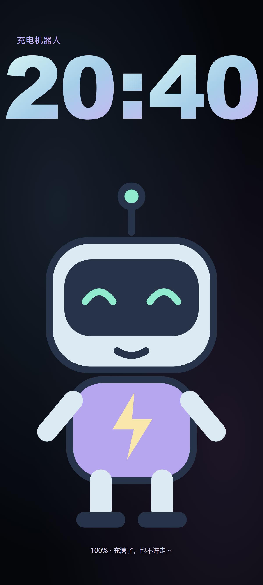
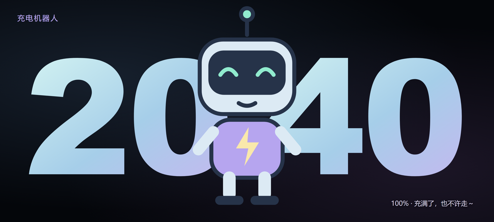

# ChargeMate

English | [简体中文](README.md)

Android wireless-charging pet and clock: when you connect a wireless charger, it shows a full-screen original character with a live clock, and exits after the connection is stably disconnected. Runs fully offline, with no accounts, ads, or network permission.

Current version **0.8.0**, Android 10 (API 29) and above.

> **This project is for learning only.** It exists to study Android development (Compose, foreground services, the charging-session state machine, offline WebView rendering, and so on). It is not a commercial product and grants no rights to any third-party assets, runtimes, characters, or trademarks. Do not use it for commercial releases, app-store publishing, or redistribution; a learning purpose does not replace a license.

## Preview

| Portrait | Landscape |
| --- | --- |
|  |  |

Rendered with the project's own original character; for illustration only.

## Features

- Wireless charging triggers a full-screen display; wired charging is optional. It exits after a stable disconnect and does not pop up repeatedly within the same session.
- Original characters: Charging Robot and Charging Cat (SVG, MIT-licensed with the project).
- Import your own PNG artwork or Spine model (you must provide the model and its runtime licenses).
- Large clock, portrait and landscape layouts, battery caption.
- Tap to interact, swipe left/right to switch characters, swipe up or press Back to exit.
- Two modes: immediate display (foreground service) and system screensaver; it reduces load as the device heats up and exits on full charge or timeout.

## Not included

- No game or anime character models; the default character is an original SVG.
- Spine models must be imported by the user; the repository ships only the Spine runtime, not model files.

## Build

You need a JDK, the Android SDK, and the Gradle wrapper in this repository. Set `sdk.dir` in your local `local.properties` (do not commit that file).

```powershell
.\gradlew.bat :app:assembleDebug
```

Spine import is enabled by default (`pixi7.min.js` / `pixi-spine.js` ship with the repository), so no extra files are required. If you do not have a Spine license, disable it with `-PspineEnabled=false`.

## Import your own character

**PNG**: Home → "Import assets → Select PNG file" → preview in the character library → "Use this character" → "Adjust image position and size", then save the portrait and landscape compositions separately. Limits: 32 MiB, 8192 px per side.

**Spine**: one ZIP per model (`.skel` or skeleton JSON + `.atlas` + all textures, same directory, case-sensitive names); versions 3.7–4.1 are supported. Enable it from the character library after import.

You are responsible for confirming the rights to any model or asset you import. The app stores imported copies only on the local device and never uploads or shares them.

## Permissions and notes

- Notifications: show the listener status and provide a tap entry point when the system blocks the automatic launch.
- Boot recovery, background execution, background pop-ups, and battery optimization vary by vendor and are not guaranteed; see the [Android compatibility notes](docs/ANDROID_COMPATIBILITY.md) for troubleshooting.
- The app requests no network permission, does not enable accessibility services, does not request root, and does not modify system security settings.

## License

- Project code and original SVG artwork: [MIT](LICENSE).
- The Spine runtime is copyright Esoteric Software and licensed per user: **every user must hold their own valid Spine Editor license**. Full terms and third-party notices: [THIRD_PARTY_NOTICES](app/src/main/assets/live2d/THIRD_PARTY_NOTICES.md) and `licenses/`.
- Third-party dependencies and any imported models keep their own licenses; this project's open-source license does not relicense them.
